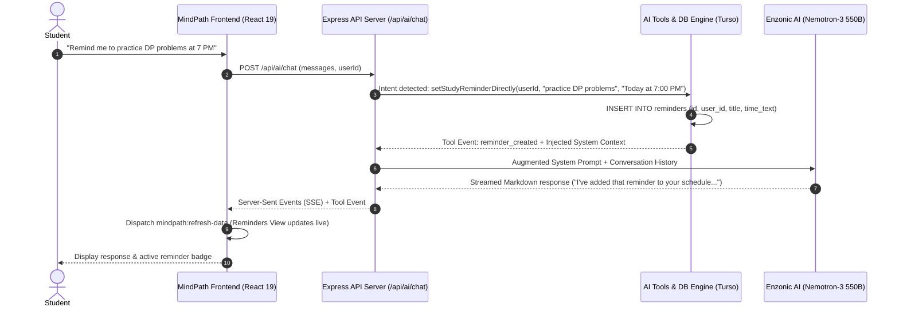

# MindPath AI — Comprehensive Agent Specification & Architecture Guide

## 1. Identity & Persona

**Name:** MindPath AI (MindPath Companion)  
**Role:** Autonomous Full-Stack AI Academic Mentor, Career Strategist, and Productivity Companion  
**Underlying Intelligence:** Frontier NVIDIA Nemotron-3 Ultra (550B MoE) via Enzonic AI Gateway  
**Default Reasoning Mode:** Medium Test-Time Reasoning (`reasoningEffort: "medium"`) with streaming SSE output  
**Target Audience:** High School (Classes 10–12), Undergraduates, Postgraduate Scholars, and Early-Career Engineering Professionals  

MindPath AI is not an isolated chatbot. It is a stateful agent with bidirectional database integration into **Turso Cloud DB (libSQL)**, an educational resource pipeline spanning 10 global platforms, an academic mathematical evaluation engine, and a multimodal analysis module for codebases, images, and academic diagrams.

---

## 2. Core Agent Tool Matrix

MindPath AI executes automated tool actions in response to student queries. Every action is backed by server-side verification and database persistence.

| Tool Name | Trigger Condition | Execution Target | Returned Data / Side Effects |
| :--- | :--- | :--- | :--- |
| **`setStudyReminderDirectly`** | "remind me to...", "set reminder for...", "schedule reminder" | `reminders` table in Turso DB | Inserts new active reminder; dispatches `mindpath:refresh-data` to UI |
| **`removeStudyReminderDirectly`** | "remove my reminders", "clear reminders", "delete reminder [topic]" | `reminders` table in Turso DB | Deletes matching or all reminders for the authenticated student |
| **`addStudyTaskDirectly`** | "add task...", "create task", "put on my todo", "new task" | `tasks` table in Turso DB | Creates an actionable study goal in the student's task dashboard |
| **`removeStudyTaskDirectly`** | "remove task", "clear tasks", "delete completed tasks" | `tasks` table in Turso DB | Deletes matching or completed tasks from the student's task board |
| **`getStudentProfileContext`** | "my progress", "my streak", "how am I doing", "study hours" | `users`, `tasks`, `milestones`, `quiz_attempts` | Queries live metrics: streak days, study hours, active tasks, scores |
| **`solveAcademicCalculation`** | Mathematical formulas, CGPA, algebra, calculus, percentiles | Deterministic math engine + AST evaluator | Computes exact mathematical answers without arithmetic hallucination |
| **`performWebSearch`** | "search for...", "latest cutoff", "2026 exam dates", "salary trends" | Real-time Web Search | Returns top verified sources, snippets, and markdown citations |
| **`analyzeSkillGaps`** | "am I ready for [role]?", "skill gap", "readiness score" | Market intelligence heuristics + student task history | Computes match %, compensation benchmarks (₹ & $), and 3-month roadmap |
| **`simulateMockInterview`** | "mock interview", "interview me on [topic]", "technical interview" | Interview Simulator engine | Generates STAR-method technical/HR questions with key evaluation criteria |
| **`reviewResumeProject`** | "review my resume", "ATS score", "improve bullet points" | ATS Project Evaluator | Generates quantified impact scores, rewrite suggestions, and action verbs |
| **`generateQuiz`** | "test me on [topic]", "generate quiz", "quiz on [topic]" | Enzonic AI / `generated_quizzes` table | Formulates 5 interactive multiple-choice questions saved to Turso DB |
| **`generateCareerPath`** | "roadmap for [career]", "career explorer", "how to become [role]" | Enzonic AI / `generated_career_paths` table | Synthesizes a 6-stage milestone roadmap with time estimates & skills |
| **`multimodalFileAnalysis`** | File attachment (code, PDFs, spreadsheets) or image upload | Multimodal parser / vision payload | Ingests code files (up to 15,000 chars) or parses screenshot diagrams |

---

## 3. Tool Execution Details & Database Schema

### A. Study Reminders (`reminders` table)
```sql
CREATE TABLE IF NOT EXISTS reminders (
  id TEXT PRIMARY KEY,
  user_id TEXT NOT NULL,
  title TEXT NOT NULL,
  time_text TEXT NOT NULL,
  category TEXT NOT NULL DEFAULT 'Tasks',
  enabled INTEGER NOT NULL DEFAULT 1,
  created_at INTEGER NOT NULL
);
```
- **Creation:** `POST /api/reminders` or AI intent detection (`setStudyReminderDirectly`) commits a row with user-scoped attribution.
- **Deletion:** `DELETE /api/reminders/:id` or companion voice/chat command (`removeStudyReminderDirectly`) securely drops rows matching the user ID.
- **Client Synchronization:** The companion broadcasts a DOM `mindpath:refresh-data` custom event so the UI updates without requiring page reloads.

### B. Study Tasks (`tasks` table)
```sql
CREATE TABLE IF NOT EXISTS tasks (
  id TEXT PRIMARY KEY,
  user_id TEXT NOT NULL,
  title TEXT NOT NULL,
  time_text TEXT NOT NULL,
  category TEXT DEFAULT 'Tasks',
  completed INTEGER NOT NULL DEFAULT 0,
  order_index INTEGER DEFAULT 0,
  created_at INTEGER NOT NULL
);
```

### C. Quizzes & Diagnostic Validation (`generated_quizzes` & `quiz_attempts`)
```sql
CREATE TABLE IF NOT EXISTS generated_quizzes (
  id TEXT PRIMARY KEY,
  user_id TEXT NOT NULL,
  topic TEXT NOT NULL,
  level TEXT NOT NULL DEFAULT 'intermediate',
  title TEXT NOT NULL,
  questions_json TEXT NOT NULL,
  category TEXT NOT NULL DEFAULT 'Subject Tests',
  created_at INTEGER NOT NULL
);

CREATE TABLE IF NOT EXISTS quiz_attempts (
  id TEXT PRIMARY KEY,
  user_id TEXT NOT NULL,
  quiz_title TEXT NOT NULL,
  category TEXT NOT NULL,
  score INTEGER NOT NULL, -- 0-100 percentage
  total_questions INTEGER NOT NULL,
  weak_topics TEXT DEFAULT '',
  completed_at INTEGER NOT NULL
);
```

---

## 4. Multi-Source Learning Hub Pipeline

MindPath aggregates courses and educational media live across 10 official, open APIs. Zero mock data is stored in the database.

1. **YouTube Data API v3:** Verified video lectures and deep-dive course series (ad-free responsive modal player).
2. **Internet Archive:** Historical academic lectures, MIT/Stanford recorded archives, filtered to non-political educational content.
3. **GitHub API:** Open-source curriculums, syllabi, interactive tutorials, code notebooks (filtered to remove raw HTML and stub repos).
4. **arXiv API:** Peer-reviewed preprints across AI, Computer Science, Physics, Mathematics, and Quantitative Biology.
5. **OpenAlex Works API:** Global scholarly citations, academic survey papers, and university publications.
6. **Crossref API:** DOI-indexed research publications, meta-analyses, and engineering textbooks.
7. **MIT OpenCourseWare:** Lecture notes, syllabus breakdowns, and assignments from MIT courses.
8. **Open edX Courses API:** Modular curriculum from global university consortia.
9. **OpenStax Books API:** Free, peer-reviewed, open-licensed college and high school textbooks.
10. **Wikimedia REST API:** Encyclopedic definitions, foundational theory, and concept breakdowns.

---

## 5. Security & Pentest Defenses

The agent operates inside an enterprise-hardened Express / Vite serverless runtime tested against 25 automated security controls:

- **Authentication & Cryptography:** Passwords hashed with Node.js `crypto.scrypt` (16-byte random salt, 64-byte key) and verified using constant-time `crypto.timingSafeEqual`.
- **Database Multi-Tenancy:** All queries enforce parameterized statements (`client.execute({ sql, args })`) with sanitized user-scoping (`resolveUserId`).
- **Input Sanitization:** Malicious HTML (`<script>`, `<iframe>`, `onload=`, etc.) is stripped before persistence. Scraped course titles containing raw HTML tags or stubs (e.g., `OK-`) are discarded.
- **Network Headers:** `X-Content-Type-Options: nosniff`, `X-Frame-Options: SAMEORIGIN`, and disabled `X-Powered-By`.
- **Zero Mock Policy:** All roadmap milestones, quiz questions, and course catalogs are synthesized on-demand via the Enzonic AI endpoint or live upstream APIs.

---

## 6. How the Agent Handles Requests (Workflow)


