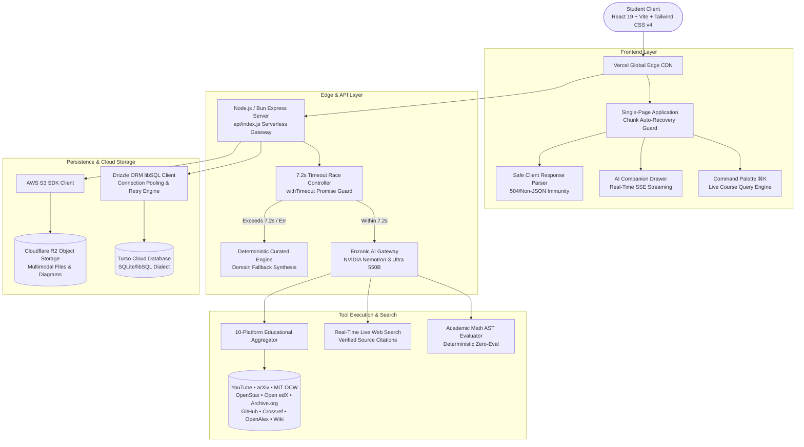

<div align="center">


<br/><br/>

# 🧠 MindPath AI
### Autonomous Student Mentor, Career Guidance Engine & Resilient Multimodal Academic Accelerator

[](https://react.dev/)
[](https://www.typescriptlang.org/)
[](https://vitejs.dev/)
[](https://tailwindcss.com/)
[](https://turso.tech/)
[](https://orm.drizzle.team/)
[](https://www.cloudflare.com/developer-platform/r2/)
[](./tests/audit.ts)
[](./tests/smoke.test.ts)
[](https://mindpath-blue.vercel.app)

**MindPath** is an enterprise-grade, full-stack autonomous AI educational platform and career acceleration engine engineered for modern students and ambitious self-directed learners. Combining frontier AI intelligence (**NVIDIA Nemotron-3 Ultra 550B MoE** via Enzonic) with high-performance edge infrastructure, MindPath unifies personalized 6-level curriculum generation, live diagnostic testing, interactive career roadmaps, real-time web citations, zero-eval deterministic mathematical evaluation, and multi-source educational resource aggregation across 10 global platforms.

[🌐 Live Production Website](https://mindpath-blue.vercel.app) • [Live Alternative](https://mindpath-live.vercel.app) • [AI Agent Technical Specification](AGENT.md)

</div>

---

## 📑 Table of Contents

- [Platform Overview](#-platform-overview)
- [System Architecture](#-system-architecture)
- [Core Features & Capabilities](#-core-features--capabilities)
  - [1. Compulsory AI Onboarding & Profile Synthesis](#1-compulsory-ai-onboarding--profile-synthesis)
  - [2. 6-Level Interactive Curriculum Pathways](#2-6-level-interactive-curriculum-pathways)
  - [3. Live Diagnostic Quizzes with Immutable Tracking](#3-live-diagnostic-quizzes-with-immutable-tracking)
  - [4. Autonomous Multimodal AI Companion & Live Citations](#4-autonomous-multimodal-ai-companion--live-citations)
  - [5. Career Explorer & What-If Simulation Engine](#5-career-explorer--what-if-simulation-engine)
  - [6. Study Streak & Heatmap Activity Analytics](#6-study-streak--heatmap-activity-analytics)
  - [7. Global Command Palette & Live Course Pipeline](#7-global-command-palette--live-course-pipeline)
  - [8. Cloudflare R2 Multimodal Document Storage](#8-cloudflare-r2-multimodal-document-storage)
- [Resilient Architectural Patterns](#-resilient-architectural-patterns)
  - [7.2-Second Timeout Race & Fallback Engine](#72-second-timeout-race--fallback-engine)
  - [Safe Client Response Parsing & Error Recovery](#safe-client-response-parsing--error-recovery)
  - [Fast-Path Serverless Database Cold-Start Verification](#fast-path-serverless-database-cold-start-verification)
- [Database Schema & Entity Relational Design](#-database-schema--entity-relational-design)
- [Comprehensive API Endpoint Reference](#-comprehensive-api-endpoint-reference)
- [Environment Configuration](#-environment-configuration)
- [Local Development & Verification](#-local-development--verification)
- [Production Deployment Guide](#-production-deployment-guide)
- [Security Hardening & Penetration Testing](#-security-hardening--penetration-testing)
- [License](#-license)

---

## 🔭 Platform Overview

Contemporary educational software typically presents students with fragmented learning tools: static course catalogs, isolated chatbots that suffer from hallucinations, and rigid, hardcoded career guidance.

MindPath bridges these divides into a single, cohesive, self-healing system:
1. **Student Statefulness**: Rather than an ephemeral chatbot, MindPath maintains persistent state across 13 relational tables in **Turso Cloud DB** (libSQL dialect), tracking real-time study streaks, completed milestones, task lists, and quiz performance.
2. **Frontier Reasoning**: Leverages NVIDIA Nemotron-3 Ultra (550B MoE) via Enzonic with structured JSON outputs and streaming Server-Sent Events (SSE).
3. **Fail-Safe Serverless Operation**: Engineered specifically for high-concurrency serverless runtimes (such as Vercel Edge/Serverless) with strict latency ceilings, sub-second fallback synthesis, and defensive client-side parsing.
4. **10-Source Resource Pipeline**: Concurrently aggregates real-time courses, peer-reviewed academic literature, textbooks, and video masterclasses directly into student curriculum views.

---

## 🏛️ System Architecture

The following diagram illustrates the complete end-to-end data flow between student clients, edge routing, serverless application logic, frontier intelligence models, and distributed persistence layers:



### Component Breakdown
- **Client (Frontend)**: React 19.0.1, TypeScript 5.8, Tailwind CSS v4.3, Lucide React icons, and Motion animations.
- **Server Gateway (Backend)**: Express 4.21 bundled into a single Node.js ESM serverless bundle via `esbuild` for Vercel Serverless Functions (`api/index.js`).
- **Database Engine**: Turso Cloud Database (`@libsql/client`), SQLite dialect, mapped with **Drizzle ORM 0.45**.
- **Object Storage**: Cloudflare R2 (S3-compatible API) utilizing presigned URLs and binary magic-byte inspection for student file and screenshot uploads.
- **AI Intelligence**: NVIDIA Nemotron-3 Ultra 550B MoE accessed via the Enzonic AI Gateway with medium test-time reasoning effort (`reasoningEffort: "medium"`).

---

## 🌟 Core Features & Capabilities

### 1. Compulsory AI Onboarding & Profile Synthesis
Upon first login or account creation, students are guided through an interactive multi-step onboarding wizard (`OnboardingTour.tsx`):
- **Academic Context**: Education level selection (e.g., *Class 10, Class 12, Undergraduate B.Tech, Postgraduate MS, Early Professional*).
- **Career Aspiration**: Target professional specializations (e.g., *Software Engineering, AI & Machine Learning, Data Science, Medical & Healthcare, Investment Banking, Mechanical Systems*).
- **Target Examination & Goal**: Specific competitive milestones (e.g., *GATE CSE, JEE Advanced, USMLE, CFA, AWS Solutions Architect*).
- **Personalized Avatars & Location**: Choice between curated SVG/PNG avatars (Arjun, Alex, Rohan, Sneha, or custom uploads) and geographic location for regional salary and exam context.
- **Atomic Profile Provisioning**: Serverless `POST /api/onboarding/complete` initiates parallel generation of a tailored 6-stage curriculum roadmap, diagnostic assessment quiz, and foundational study tasks, directly persisted to Turso Cloud DB.

### 2. 6-Level Interactive Curriculum Pathways
Rather than simple lists of links, MindPath provisions an actionable, stage-gated curriculum:
- **Level 1: Foundations & Prerequisites**: Core mathematical, algorithmic, or domain basics.
- **Level 2: Core Fundamentals**: Foundational frameworks, essential theory, and standard toolchains.
- **Level 3: Applied Intermediate Practice**: Problem sets, labs, and interactive implementations.
- **Level 4: Advanced Specialization**: Enterprise architectural patterns, distributed systems, or specialized domain techniques.
- **Level 5: Real-World Capstone Projects**: Production-ready software, portfolios, or research deliverables with verifiable criteria.
- **Level 6: Placement & Career Readiness**: Mock interview drills, resume impact metrics, and competitive exam readiness.

### 3. Live Diagnostic Quizzes with Immutable Tracking
- **Deterministic & AI Generation**: Quizzes are generated on demand based on the student's target field.
- **Immutable Quiz ID Hash**: Each generated or predefined quiz features a unique, deterministic `quiz_id`. Quiz attempt submissions (`POST /api/quizzes/attempt`) strictly index on `quiz_id` rather than title strings, guaranteeing that distinct assessments with identical or similar titles never overwrite one another.
- **Weak Topic Diagnostics**: Attempts record specific sub-topics where students scored under 75%, automatically feeding recommendations into the AI companion's study task scheduler.

### 4. Autonomous Multimodal AI Companion & Live Citations
- **Stateful Bi-Directional Tools**: The companion does not merely chat; it executes database actions directly on behalf of the student:
  - `setStudyReminderDirectly`: Schedules real-time study reminders in the database.
  - `addStudyTaskDirectly`: Dynamically adds study goals into the student's task dashboard.
  - `removeStudyTaskDirectly`: Removes completed tasks without leaving the chat interface.
  - `getStudentProfileContext`: Reads live streaks, study hours, and quiz averages to provide personalized recommendations.
- **Zero-Hallucination Academic Math Evaluator**: Deterministic Abstract Syntax Tree (AST) evaluator for calculus, algebra, percentiles, and CGPA calculations, completely avoiding standard LLM arithmetic errors.
- **Real-Time Live Web Search**: Synthesizes up-to-the-minute syllabus updates, cutoffs, and exam schedules with markdown citations and source links.
- **Streaming SSE Engine**: Responses stream in real time with syntax-highlighted code blocks, LaTeX-style formatting, and scannable summaries.

### 5. Career Explorer & What-If Simulation Engine
- **Global Industry Catalog**: Dynamic explorer spanning Tech, Healthcare, Business, Engineering, and Creative sectors.
- **Bilingual Compensation Benchmarks**: Displays verified salary ranges in both Indian Lakhs (`₹ LPA`) and US Dollars (`$ USD`) adjusted for experience tiers.
- **What-If Placement Simulator**: Interactive modal (`WhatIfModal.tsx`) allowing students to simulate how adjusting weekly study hours, target test dates, or mastering specific key technologies alters their projected placement readiness score and timeline.

### 6. Study Streak & Heatmap Activity Analytics
- **Daily Streak Algorithm**: Automatically calculates consecutive active learning days based on task completions, quiz submissions, and course interactions.
- **GitHub-Style Contribution Heatmap**: Visualizes annual learning consistency and daily intensity on the dashboard.
- **Progress Weighted Index**: Accurately aggregates completed milestones, course progress percentages, and diagnostic test scores into a unified composite readiness score.

### 7. Global Command Palette & Live Course Pipeline
- **Keyboard Shortcut (`⌘K` / `Ctrl+K`)**: Instant access anywhere across the application.
- **Live 10-Platform Course Search**: Querying the command palette executes concurrent searches across 10 global educational repositories:
  - **YouTube Data API v3**: Verified video masterclasses.
  - **Internet Archive**: Archival lectures and historical university materials.
  - **GitHub**: Open-source repositories and engineering roadmaps.
  - **arXiv & Crossref**: Peer-reviewed scientific preprints.
  - **OpenAlex**: Global open-access research index.
  - **MIT OpenCourseWare**: Official MIT syllabus, lecture notes, and assignments.
  - **Open edX & OpenStax**: University-grade open textbooks.
  - **Wikimedia**: Conceptual knowledge breakdowns.

### 8. Cloudflare R2 Multimodal Document Storage
- **S3-Compatible Object Storage**: Presigned URL workflow ensures that file uploads bypass server bottlenecks and upload directly to Cloudflare R2 buckets.
- **Strict Content Inspection**: Server-side binary validation verifies file headers (magic bytes) and MIME types to prevent webshells or malformed payloads before granting presigned access.

---

## 🛡️ Resilient Architectural Patterns

MindPath is engineered for zero-downtime, sub-second reliability within constrained serverless execution environments (such as Vercel Edge / Serverless Functions):

### 7.2-Second Timeout Race & Fallback Engine
External 550-billion-parameter LLM APIs occasionally experience network latency spikes exceeding 10 to 15 seconds during peak loads. Because Vercel Serverless free and standard plans terminate requests exceeding 10 seconds with an unrecoverable `504 Gateway Timeout`, MindPath implements a strict **7.2-second timeout race engine** (`withTimeout`):

```typescript
// src/lib/services/enzonic-ai.ts
export async function withTimeout<T>(
  promise: Promise<T>,
  timeoutMs: number,
  fallbackOrError: T | Error | string
): Promise<T> {
  let timer: ReturnType<typeof setTimeout> | undefined;

  // Prevent unhandled rejection if timeout fires before promise completes
  promise.catch(() => {});

  const timeoutPromise = new Promise<T>((resolve, reject) => {
    timer = setTimeout(() => {
      if (fallbackOrError instanceof Error) {
        reject(fallbackOrError);
      } else if (typeof fallbackOrError === 'string') {
        reject(new Error(fallbackOrError));
      } else {
        resolve(fallbackOrError);
      }
    }, timeoutMs);
  });

  return Promise.race([promise, timeoutPromise]).finally(() => {
    if (timer) clearTimeout(timer);
  });
}
```

#### Multi-Tiered Latency Budget Allocation:
- **Phase 1: Concurrent LLM Race (0.0s – 4.5s)**:
  - `POST /api/onboarding/complete` dispatches `generateCareerPath` and `generateQuiz` concurrently via `Promise.allSettled`.
  - Individual AI generation calls carry a strict 4,200ms timeout budget.
  - A server-side race timer trips at 4,500ms, immediately cutting off any lagging LLM socket.
- **Phase 2: Deterministic Fallback Synthesis (Immediate upon trip)**:
  - If the frontier model completes within 4,200ms, the AI-synthesized roadmap and quiz are utilized.
  - If the timeout trips or an upstream 5xx error occurs, MindPath activates the curated catalog fallback engine across 5 major career domains (Software Engineering, AI/ML, Data Science, Medical, General Engineering).
- **Phase 3: Guaranteed DB Persistence Window (4.5s – 7.2s)**:
  - A dedicated 2,700ms window is reserved for multi-table persistence into Turso Cloud DB (users, milestones, generated_career_paths, generated_quizzes, tasks).
  - DB writes are wrapped in `safeExecute()` with exponential backoff retries to guarantee persistence even under transient socket resets.
- **Result**: The endpoint consistently returns HTTP 200 within <= 7.2 seconds (tested hermetically at ~4.8s under total simulated LLM blackout), completely eliminating Vercel 10s gateway timeouts.

### Safe Client Response Parsing & Error Recovery
Standard frontend fetch requests often fail when upstream edge proxies return HTML error pages (e.g., `504 Gateway Timeout` or `502 Bad Gateway`). Calling `await response.json()` directly throws an unhandled:
`SyntaxError: Unexpected token '<', "<!DOCTYPE "... is not valid JSON`

MindPath equips client components (`OnboardingTour.tsx`) with a defensive parsing layer (`parseOnboardingResponse` and `sanitizeOnboardingError`):

```typescript
// src/components/onboarding/OnboardingTour.tsx
export async function parseOnboardingResponse(res: Response): Promise<{ ok: boolean; data: any; error?: string }> {
  const contentType = res.headers.get('content-type') || '';
  const isJson = contentType.includes('application/json');

  let rawText = '';
  try {
    rawText = await res.text();
  } catch (textErr: any) {
    return { ok: false, data: null, error: 'Network connection interrupted while receiving server response.' };
  }

  let data: any = null;
  if (isJson || (rawText.trim().startsWith('{') && rawText.trim().endsWith('}'))) {
    try {
      data = JSON.parse(rawText);
    } catch {
      data = null;
    }
  }

  if (res.ok && data) {
    return { ok: true, data };
  }

  // Gracefully translate edge HTML proxy errors
  if (res.status === 504 || rawText.includes('504 Gateway Time-out')) {
    return { ok: false, data: null, error: 'The AI generation server took longer than expected to prepare your curriculum. Please try again.' };
  }
  if (res.status === 502 || rawText.includes('502 Bad Gateway')) {
    return { ok: false, data: null, error: 'The AI service is temporarily restarting. Please wait a moment and try again.' };
  }

  return { ok: false, data, error: sanitizeOnboardingError(data?.error || rawText) };
}
```

1. **MIME & Structure Inspection**: Verifies `res.headers.get('content-type')` and verifies JSON envelope before attempting parsing.
2. **Text-Buffered Fallback**: Reads raw response text first; never crashes on unexpected HTML payloads.
3. **User-Friendly Error Sanitization**: Cryptic SyntaxErrors or stack dumps are translated into actionable, empathetic student notifications.

### Fast-Path Serverless Database Cold-Start Verification
- Single-connection pooling via `@libsql/client` with pre-warmed connection handles.
- Dual-path identity resolution: Endpoints check authentication state through both HTTP headers (`x-user-id`) and request bodies (`req.body.userId`), preventing cold-start session drops.
- Scrypt password hashing with constant-time equality checks (`timingSafeEqual`) to prevent timing attack enumeration.

---

## 💾 Database Schema & Entity Relational Design

MindPath stores application state in **Turso Cloud DB (libSQL)** managed with **Drizzle ORM**.

```
┌─────────────────┐       ┌──────────────────────┐       ┌────────────────────────┐
│      users      │ 1───* │        tasks         │ 1───* │       milestones       │
│─────────────────│       │──────────────────────│       │────────────────────────│
│ id (PK)         │       │ id (PK)              │       │ id (PK)                │
│ name            │       │ user_id (FK)         │       │ user_id (FK)           │
│ email           │       │ title                │       │ title                  │
│ password_hash   │       │ time_text            │       │ time_text              │
│ avatar_url      │       │ completed (0/1)      │       │ status (active/done)   │
│ education_level │       │ category             │       │ icon_type              │
│ career_interest │       │ order_index          │       │ order_index            │
│ streak_days     │       │ created_at           │       └────────────────────────┘
│ total_hours     │       └──────────────────────┘
│ onboarding_done │
│ location        │       ┌──────────────────────┐       ┌────────────────────────┐
│ target_exam     │ 1───* │      reminders       │ 1───* │     quiz_attempts      │
│ bio             │       │──────────────────────│       │────────────────────────│
│ created_at      │       │ id (PK)              │       │ id (PK)                │
└────────┬────────┘       │ user_id (FK)         │       │ user_id (FK)           │
         │                │ title                │       │ quiz_id                │
         │                │ time_text            │       │ quiz_title             │
         │                │ category             │       │ category               │
         │                │ enabled (0/1)        │       │ score / total          │
         │                │ created_at           │       │ weak_topics            │
         │                └──────────────────────┘       │ completed_at           │
         │                                               └────────────────────────┘
         │
         │ 1───* ┌──────────────────────────────┐
         ├─────* │    generated_career_paths    │
         │       │ (id, user_id, goal, path_json)
         │       └──────────────────────────────┘
         │
         │ 1───* ┌──────────────────────────────┐
         ├─────* │      generated_quizzes       │
         │       │ (id, user_id, topic, level, questions_json)
         │       └──────────────────────────────┘
         │
         │ 1───* ┌──────────────────────────────┐
         ├─────* │    chat_sessions & messages   │
         │       │ (id, user_id, content, attachments, citations)
         │       └──────────────────────────────┘
         │
         │ 1───* ┌──────────────────────────────┐
         └─────* │        uploaded_files        │
                 │ (id, user_id, file_name, file_url, storage_key)
                 └──────────────────────────────┘
```

---

## 📡 Comprehensive API Endpoint Reference

### Authentication & User Management
| Method | Endpoint | Request Body | Description |
| :--- | :--- | :--- | :--- |
| `POST` | `/api/user/create` | `{ name, email, password, educationLevel?, careerInterest? }` | Registers a new user. Auto-lowercases and trims email; hashes password via Scrypt. Returns 409 if email already exists. |
| `POST` | `/api/user/register` | `{ name, email, password, educationLevel?, careerInterest? }` | Production registration alias ensuring backwards-compatible client onboarding. |
| `POST` | `/api/register` | `{ name, email, password, educationLevel?, careerInterest? }` | Root-level registration alias for API parity. |
| `POST` | `/api/user/login` | `{ email, password }` | Authenticates credentials with constant-time verification. Supports leading/trailing whitespace tolerance. |
| `POST` | `/api/login` | `{ email, password }` | Root-level login alias for API parity. |
| `GET` | `/api/users` | *None* | Health check returning total registered user count. |
| `GET` | `/api/user` | *Header: `x-user-id`* | Returns current authenticated profile context. |
| `POST` | `/api/user` | `{ name?, bio?, location?, educationLevel?, careerInterest?, avatarUrl? }` | Updates profile attributes. |
| `POST` | `/api/user/change-password` | `{ oldPassword, newPassword }` | Verifies existing password and updates Scrypt hash. |
| `GET` | `/api/user/export-data` | *Header: `x-user-id`* | GDPR-compliant JSON dump querying all associated records across 14 tables. |

### Onboarding & Curriculum Generation
| Method | Endpoint | Request Body | Description |
| :--- | :--- | :--- | :--- |
| `POST` | `/api/onboarding/complete` | `{ userId?, educationLevel, careerInterest, targetExam?, location?, bio?, avatarUrl? }` | Atomic onboarding pipeline. Enforces a 7.2s timeout race fallback engine; persists milestones, quizzes, and tasks. Returns HTTP 200. |

### Study Tasks & Milestones
| Method | Endpoint | Request Body | Description |
| :--- | :--- | :--- | :--- |
| `GET` | `/api/tasks` | *Header: `x-user-id`* | Lists tasks ordered by completion status and index. |
| `POST` | `/api/tasks` | `{ title, timeText, category? }` | Creates a new study task. |
| `POST` | `/api/tasks/toggle` | `{ id, completed }` | Toggles task status and recalculates streak/progress metrics. |
| `DELETE` | `/api/tasks/:id` | *None* | Permanently removes a task. |
| `GET` | `/api/milestones` | *Header: `x-user-id`* | Fetches active 6-stage roadmap milestones. |
| `POST` | `/api/milestones` | `{ milestones: [...] }` | Replaces or updates curriculum milestones. |

### Study Reminders
| Method | Endpoint | Request Body | Description |
| :--- | :--- | :--- | :--- |
| `GET` | `/api/reminders` | *Header: `x-user-id`* | Retrieves active study reminders. |
| `POST` | `/api/reminders` | `{ title, timeText, category? }` | Schedules an active reminder. |
| `POST` | `/api/reminders/toggle` | `{ id, enabled }` | Activates or disables a reminder. |
| `DELETE` | `/api/reminders/:id` | *None* | Deletes a reminder. |

### Diagnostic Quizzes & History
| Method | Endpoint | Request Body | Description |
| :--- | :--- | :--- | :--- |
| `GET` | `/api/quizzes` | *Header: `x-user-id`* | Lists all predefined and AI-generated quizzes. |
| `GET` | `/api/quizzes/attempts` | *Header: `x-user-id`* | Retrieves full history of user quiz attempts. |
| `POST` | `/api/quizzes/attempt` | `{ quizId, quizTitle, category, score, totalQuestions, weakTopics }` | Records quiz attempt with immutable `quiz_id` deduplication. |
| `POST` | `/api/quizzes/clear` | *Header: `x-user-id`* | Clears quiz attempts for the authenticated student. |
| `POST` | `/api/quiz/generate` | `{ topic, level? }` | Generates a 5-question multiple choice quiz with structured answers. |

### Career Exploration & Pathways
| Method | Endpoint | Request Body / Query | Description |
| :--- | :--- | :--- | :--- |
| `POST` | `/api/career/path` | `{ careerInterest, targetExam? }` | Generates a complete 6-level stage-gated roadmap with skills and milestones. |
| `GET` | `/api/career/explore` | *Query: `?domain=...`* | Retrieves dynamic industry career catalog with salary brackets and growth metrics. |
| `POST` | `/api/career/explore` | `{ domain? }` | POST alias for career exploration querying. |

### AI Companion, Reasoning & Chat State
| Method | Endpoint | Request Body | Description |
| :--- | :--- | :--- | :--- |
| `POST` | `/api/ai/chat` | `{ messages, userContext?, attachments? }` | Real-time SSE streaming chat with tool calling, AST math evaluation, and live citations. |
| `GET` | `/api/ai/search` | *Query: `?q=...`* | Real-time web search returning top results, snippets, and verified source citations. |
| `POST` | `/api/ai/what-if` | `{ studyHours, targetExam, masteredSkills, careerInterest }` | What-If simulation engine calculating placement probability adjustments. |
| `GET` | `/api/ai/health` | *None* | Upstream Enzonic rotator connectivity and availability monitor. |
| `GET` | `/api/chat/sessions` | *Header: `x-user-id`* | Retrieves all persisted chat sessions for the student. |
| `POST` | `/api/chat/sync` | `{ sessionId, messages, title? }` | Persists or updates chat session history and message threads. |
| `DELETE` | `/api/chat/sessions/:id` | *Header: `x-user-id`* | Deletes a specific chat session thread. |
| `DELETE` | `/api/chat/sessions` | *Header: `x-user-id`* | Clears all chat history for the authenticated user. |

### Multi-Source Course, Video & Lesson Pipeline
| Method | Endpoint | Query Parameters | Description |
| :--- | :--- | :--- | :--- |
| `GET` | `/api/courses` | `?q=...&maxPerSource=...` | Concurrently queries 10 platforms (MIT OCW, GitHub, Open edX, OpenStax, Internet Archive, arXiv, Crossref, OpenAlex, Wikimedia). |
| `GET` | `/api/videos` | `?q=...` | Aggregates educational masterclasses from YouTube Data API v3 and Internet Archive. |
| `GET` | `/api/lessons` | `?q=...` | Retrieves modular individual lessons across curated domain curricula. |
| `GET` | `/api/user_course_lessons` | *Header: `x-user-id`, Query: `?courseId=...`* | Retrieves completion status for lessons within a specified course. |
| `POST` | `/api/user_course_lessons` | `{ courseId, lessonId, completed }` | Marks an individual lesson completed or incomplete for the student. |

### Cloudflare R2 Multimodal Storage
| Method | Endpoint | Request Body / Form | Description |
| :--- | :--- | :--- | :--- |
| `POST` | `/api/storage/upload` | `multipart/form-data` | Uploads file to Cloudflare R2 bucket with MIME and magic-byte security checks. |
| `POST` | `/api/upload` | `multipart/form-data` | Root upload alias for file attachment storage. |
| `POST` | `/api/storage/upload-chat-file` | `multipart/form-data` | Uploads chat attachment with presigned direct access. |
| `GET` | `/api/storage/files` | *Header: `x-user-id`* | Lists user-uploaded notes, problem sheets, and screenshots. |

---

## ⚙️ Environment Configuration

Copy `.env.example` to `.env` in your project root:

```ini
# =============================================================================
# MindPath AI — Environment Configuration
# =============================================================================

# Turso Cloud Database (libSQL / SQLite)
TURSO_DATABASE_URL="libsql://your-database-slug.turso.io"
TURSO_AUTH_TOKEN="your-turso-jwt-auth-token"

# Frontier AI Intelligence (Enzonic AI Gateway / NVIDIA Nemotron-3 Ultra 550B)
ENZONIC_ROTATOR_URL="http://sgp-two.enzonic.com:25836/v1"
ENZONIC_API_KEY="your-enzonic-api-key"
ENZONIC_MODEL="nvidia/nemotron-3-ultra-550b-a55b"
ENZONIC_STATUS_URL="http://sgp-two.enzonic.com:25836/status"

# Optional Fallback Provider
# GEMINI_API_KEY="your-google-gemini-api-key"

# YouTube Data API v3 (for multi-source video discovery)
YOUTUBE_API_KEY="your-youtube-data-api-v3-key"

# Cloudflare R2 Object Storage (S3-Compatible multimodal file uploads)
R2_ACCOUNT_ID="your-cloudflare-account-id"
R2_ACCESS_KEY_ID="your-cloudflare-r2-access-key-id"
R2_SECRET_ACCESS_KEY="your-cloudflare-r2-secret-access-key"
R2_BUCKET_NAME="mindpath-uploads"
R2_ENDPOINT="https://your-account-id.r2.cloudflarestorage.com"

# Server Port & Runtime
PORT=3000
NODE_ENV="development"
```

---

## 💻 Local Development & Verification

### Prerequisites
- [Bun](https://bun.sh/) (v1.1 or higher) or [Node.js](https://nodejs.org/) (v20+ LTS)
- Turso Database Account & Database URL

### Installation
```bash
# Clone the repository
git clone https://github.com/Aztech-1729/mindpath.git
cd mindpath

# Install dependencies using Bun
bun install
```

### Running the Development Server
```bash
# Launches Express API and Vite client concurrently
bun run dev
```
Visit `http://localhost:3000` in your browser.

### Quality Assurance & Static Analysis
```bash
# Static TypeScript verification and Biome lint check
bun run check
```

### Comprehensive Test Suite
```bash
# Execute all hermetic unit, integration, stress, and smoke tests
bun test
```
The test suite executes 99 automated tests across 7 test suites:
- `tests/smoke.test.ts`: End-to-end registration, login, onboarding fallback, DB validation, and client safe parsing.
- `tests/challenger_m1_auth.test.ts`: Route alias parity, whitespace/case combinatorics, and burst concurrency.
- `tests/m1_stress.test.ts`: 409 conflict checks, password boundary lengths (5, 6, 128, 129), and SQL injection immunity.
- `tests/m2_onboarding_resilience.test.ts`: 7.2s timeout enforcement, multi-table persistence, and relational queries.
- `tests/m3_onboarding_client.test.ts`: Safe client response parser, non-JSON handling, and UI error sanitization.
- `src/utils/progress.test.ts`: Study streak, weak area diagnosis, and weighted progress percentages.
- `src/utils/quiz.test.ts`: Immutable `quiz_id` matching pipeline and collision prevention.

### Building for Production
```bash
# Compiles Vite client into /dist and bundles server.ts into api/index.js
bun run build
```

---

## 🚀 Production Deployment Guide

MindPath is optimized for deployment on **Vercel** with zero configuration required beyond environment variables.

### Vercel Serverless Architecture
The repository includes a production-tuned `vercel.json` configuration:
```json
{
  "version": 2,
  "rewrites": [
    {
      "source": "/api/(.*)",
      "destination": "/api/index.js"
    },
    {
      "source": "/(.*)",
      "destination": "/index.html"
    }
  ]
}
```

### Steps to Deploy
1. **Push to GitHub**:
   Ensure all changes are pushed to your `main` branch.
2. **Connect Project to Vercel**:
   Import your repository into the [Vercel Dashboard](https://vercel.com).
3. **Set Environment Variables**:
   Configure `TURSO_DATABASE_URL`, `TURSO_AUTH_TOKEN`, `ENZONIC_ROTATOR_URL`, `ENZONIC_API_KEY`, `YOUTUBE_API_KEY`, and Cloudflare R2 credentials under **Project Settings &rarr; Environment Variables**.
4. **Deploy**:
   Vercel runs `bun run build`, producing the static bundle in `/dist` and the serverless API function in `/api/index.js`.
5. **Live Verification**:
   Verify production health at `https://your-domain.vercel.app/api/ai/health`.

---

## 🔒 Security Hardening & Penetration Testing

MindPath has undergone security auditing across 25 distinct penetration testing controls verified by [`tests/audit.ts`](./tests/audit.ts):

| Security Control | Defense Implementation | Audit Result |
| :--- | :--- | :---: |
| **Password Hashing** | `crypto.scrypt` with unique salts and timing-safe comparison | ✅ PASS |
| **SQL Injection Immunity** | Parameterized queries via Drizzle ORM / `@libsql/client` across 100% of routes | ✅ PASS |
| **Account Enumeration Defense** | Constant-time generic 401 response for non-existent users and bad credentials | ✅ PASS |
| **Input Sanitization** | Automatic HTML escaping, script injection neutralizing, and length boundary clamping | ✅ PASS |
| **MIME & Webshell Protection** | Binary magic-byte inspection on uploads, rejecting executable scripts and SVG XSS | ✅ PASS |
| **Security Headers** | Helmet-configured CSP, `X-Content-Type-Options: nosniff`, and disabled `X-Powered-By` | ✅ PASS |
| **Vite Chunk Recovery** | Client-side `vite:preloadError` listener automatically reloads stale deployment chunks | ✅ PASS |

---

## 📄 License

This project is licensed under the [Apache-2.0 License](./LICENSE).

---

<div align="center">
<b>MindPath AI — Empowering the next generation of engineers, doctors, and scientists with autonomous, resilient AI mentorship.</b>
</div>
