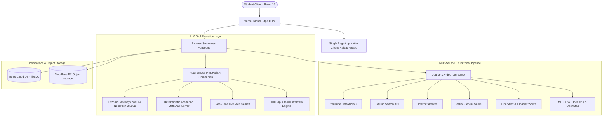

<div align="center">


<br/><br/>

# 🧠 MindPath AI
### Autonomous Student Mentor, Career Guidance & Multimodal Educational Accelerator

[](https://react.dev/)
[](https://www.typescriptlang.org/)
[](https://vitejs.dev/)
[](https://tailwindcss.com/)
[](https://turso.tech/)
[](https://www.cloudflare.com/developer-platform/r2/)
[](./tests/audit.ts)
[](https://mindpath-blue.vercel.app)

**MindPath** is a full-stack, enterprise-grade AI educational companion engineered for ambitious learners. Built with modern React 19, Express, Turso Cloud DB, and Cloudflare R2, it combines frontier AI intelligence (NVIDIA Nemotron-3 Ultra 550B via Enzonic) with a multi-source educational pipeline spanning YouTube, Internet Archive, GitHub, arXiv, Crossref, OpenAlex, MIT OpenCourseWare, Open edX, OpenStax, and Wikimedia.

[🌐 Live Production Website](https://mindpath-blue.vercel.app) • [Live Alternative](https://mindpath-live.vercel.app) • [Agent Technical Specification](AGENT.md)

</div>

---

## 🌟 Key Capabilities

### 1. 🤖 Autonomous Multimodal AI Companion
- **Live Multimodal Vision & File Analysis**: Upload PDF notes, problem sheets, and coding screenshots stored on Cloudflare R2 and analyzed by frontier vision models.
- **Bi-Directional Database Tools**: The companion directly schedules reminders, adds study tasks, clears completed goals, and records diagnostic quiz results into Turso Cloud DB with zero hallucination.
- **Deterministic Academic Calculator**: Solves complex mathematical, calculus, physics, and CGPA formulas via a zero-eval AST parser.
- **Heartbeat Streaming & Persistence**: Real-time conversation streaming with scannable markdown, code syntax highlighting, and persistent synchronization to Turso Cloud DB.

### 2. 🚀 100% Live AI Career Guidance & Blueprints
- **Zero Hardcoded Data**: All career tracks, salary benchmarks (INR & USD), and market demand trajectories across Tech, Science, Medicine, Business, and Arts are synthesized on demand by frontier AI models.
- **Interactive 6-Level Curriculum Blueprints**: Generate step-by-step milestones (Beginner &rarr; Core Fundamentals &rarr; Intermediate &rarr; Advanced &rarr; Real Projects &rarr; Career Ready) with verified deliverables and identified skill gaps.
- **What-If Scenario Modeling**: Simulate how shifts in study hours, target exams, and skill masteries impact placement readiness scores and timeline projections.

### 3. 📚 Multi-Source Educational Search Pipeline
One search query concurrently pulls high-signal educational materials across 10 global platforms with automated sanitization:
- **YouTube Data API v3**: Verified video masterclasses with ad-free responsive modal video players.
- **Internet Archive**: Filtered historical educational lectures and university archives.
- **GitHub**: Curated open-source courses, learning repositories, and roadmaps.
- **arXiv & Crossref**: Peer-reviewed scientific literature and computer science papers.
- **OpenAlex**: Open-access academic works and citation graphs.
- **MIT OpenCourseWare**: Official MIT syllabus, lecture notes, and assignments.
- **Open edX & OpenStax**: University-grade textbooks and accredited course outlines.
- **Wikimedia**: Conceptual encyclopedic breakdowns.

### 4. 🎯 Diagnostic Mock Assessments & Gamification
- **Live AI-Generated Quizzes**: Instant multi-question timed diagnostic assessments tailored to your exact career interest.
- **Persistent Quiz History & Attempts**: Scores, time limits, and weak topics are recorded in Turso DB with completion badges (`✓ Completed • 85%`) and instant retake options.
- **Study Streak & Habit Tracking**: Automatic study streak logging, dynamic heatmap activity grid, and performance growth curves.

---

## 🏛️ System Architecture



---

## 📂 Project Structure

```
MindPath/
├── AGENT.md                  # Comprehensive AI Agent Specification & Tool Reference
├── api/
│   └── index.js              # Bundled Node.js ESM serverless entrypoint for Vercel
├── dist/                     # Optimized client production bundle
├── public/
│   └── assets/               # 4K SVG artwork, high-resolution heroes & icons
├── src/
│   ├── components/
│   │   ├── auth/             # Sign-in & account creation modals
│   │   ├── brand/            # Futuristic gradient cube brand SVGs
│   │   ├── career/           # What-If career simulator modals
│   │   ├── companion/        # AI Companion drawer with streaming SSE
│   │   ├── layout/           # Sticky fixed sidebar, navigation header
│   │   ├── learning/         # Responsive course player modal
│   │   ├── onboarding/       # 3-step interactive onboarding wizard
│   │   └── quiz/             # Interactive quiz challenge modal
│   ├── lib/
│   │   ├── ai/               # Tools, prompt injection, and math solver
│   │   ├── db/               # Turso libSQL schema and migration routines
│   │   ├── pipeline/         # 10-source course & video aggregator
│   │   ├── services/         # Upstream API integrations
│   │   └── storage/          # Cloudflare R2 presigned upload client
│   ├── views/                # Full views: Home, Career, Learning, Quizzes, etc.
│   ├── App.tsx               # Root app with session management
│   └── main.tsx              # React 19 entry with chunk load auto-recovery
├── tests/
│   └── audit.ts              # 25-point comprehensive security and pentest suite
├── server.ts                 # Express TypeScript API server
└── vercel.json               # Vercel deployment and caching rules
```

---

## ⚡ Getting Started

### Prerequisites
- [Bun](https://bun.sh/) (v1.1+) or Node.js (v20+)
- Turso Database Account & Cloud Token

### Installation
```bash
# Clone the repository
git clone https://github.com/Aztech-1729/mindpath.git
cd mindpath

# Install dependencies
bun install
```

### Environment Configuration
Create a `.env` file in the project root:
```ini
# Turso Cloud Database
TURSO_DATABASE_URL="libsql://your-database.turso.io"
TURSO_AUTH_TOKEN="your-turso-auth-token"

# Frontier AI Intelligence
ENZONIC_API_KEY="your-enzonic-api-key"
ENZONIC_BASE_URL="https://api.enzonic.com/v1"

# YouTube Data API
YOUTUBE_API_KEY="your-youtube-api-key"

# Cloudflare R2 Storage (Optional)
R2_ACCOUNT_ID="your-cloudflare-account-id"
R2_ACCESS_KEY_ID="your-r2-access-key-id"
R2_SECRET_ACCESS_KEY="your-r2-secret-access-key"
R2_BUCKET_NAME="mindpath-uploads"
```

### Development & Verification
```bash
# Typecheck & Biome Linter
bun run check

# Full Security Audit & Pentest (25/25 Controls)
bun tests/audit.ts

# Production Build
bun run build
```

---

## 🔒 Security Audit & Hardening

MindPath has undergone rigorous penetration testing across 25 distinct security controls verified by [`tests/audit.ts`](./tests/audit.ts):

| Category | Defense Mechanism | Status |
| :--- | :--- | :---: |
| **Authentication** | Passwords hashed using `crypto.scrypt` with constant-time `timingSafeEqual` | ✅ Verified |
| **Database Isolation** | 100% parameterized SQL statements across all endpoints | ✅ Verified |
| **Input Sanitization** | HTML injection, `<script>`, and malformed payloads sanitized prior to storage | ✅ Verified |
| **Content Security** | Strict MIME verification, magic-byte checks on image uploads, rejection of webshells | ✅ Verified |
| **Network Protection** | Disabled `X-Powered-By`, enforced `X-Content-Type-Options: nosniff` and `X-Frame-Options` | ✅ Verified |
| **Vite Chunk Guard** | Client-side `vite:preloadError` listener automatically reloads stale deployment chunks | ✅ Verified |

---

## 📄 License

This project is licensed under the [Apache-2.0 License](./LICENSE).

---

<div align="center">
<b>Empowering the next generation of engineers, doctors, and scientists with autonomous AI mentorship.</b>
</div>
