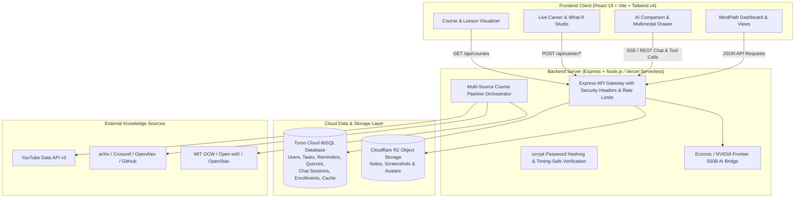

<div align="center">


<br/><br/>

# 🧠 MindPath AI
### Autonomous Student Mentor, Career Guidance & Multimodal Educational Accelerator

[](https://react.dev/)
[](https://www.typescriptlang.org/)
[](https://vitejs.dev/)
[](https://tailwindcss.com/)
[](https://turso.tech/)
[](https://www.cloudflare.com/developer-platform/r2/)
[](./tests/audit.ts)
[](https://mindpath-blue.vercel.app)

**MindPath** is a full-stack, enterprise-hardened AI educational companion engineered for ambitious learners. Built with modern React 19, Express, Turso Cloud DB, and Cloudflare R2, it combines frontier AI intelligence (NVIDIA Nemotron-3 Ultra 550B via Enzonic) with a multi-source educational pipeline spanning YouTube, Internet Archive, GitHub, arXiv, Crossref, OpenAlex, MIT OpenCourseWare, Open edX, OpenStax, and Wikimedia.

[🌐 Live Production Website](https://mindpath-blue.vercel.app) • [Live Alternative](https://mindpath-live.vercel.app)

</div>

---

## 🌟 Key Capabilities

### 1. 🤖 Autonomous Multimodal AI Companion
- **Live Multimodal Vision & File Analysis**: Upload PDF notes, problem sheets, and coding screenshots stored on Cloudflare R2 and analyzed by frontier vision models.
- **Academic Tool Execution**: Directly computes mathematical calculations with a deterministic zero-eval AST parser, performs live web queries, schedules study reminders, and tracks skill gaps.
- **Heartbeat Hearty Streaming & Persistence**: Real-time conversation streaming with scannable markdown, code syntax highlighting, and persistent synchronization to Turso Cloud DB.

### 2. 🚀 100% Live AI Career Guidance & Blueprints
- **Zero Hardcoded Data**: All career tracks, salary benchmarks (INR & USD), and market demand trajectories across Tech, Science, Medicine, Business, and Arts are synthesized on demand by frontier AI models.
- **Interactive 6-Level Curriculum Blueprints**: Generate step-by-step milestones (Beginner &rarr; Core Fundamentals &rarr; Intermediate &rarr; Advanced &rarr; Real Projects &rarr; Career Ready) with verified deliverables and identified skill gaps.
- **What-If Scenario Modeling**: Simulate how shifts in study hours, target exams, and skill masteries impact placement readiness scores and timeline projections.

### 3. 📚 Multi-Source Educational Search Pipeline
One search query concurrently pulls high-signal educational materials across 10 global platforms:
- **YouTube Data API v3**: Verified video masterclasses and full tutorial series.
- **Internet Archive**: Filtered historical educational lectures and films.
- **GitHub**: Curated open-source courses, learning repositories, and roadmaps.
- **arXiv & Crossref**: Peer-reviewed scientific literature and computer science papers.
- **OpenAlex**: Open-access academic works and citation graphs.
- **MIT OpenCourseWare**: Official MIT syllabus, lecture notes, and assignments.
- **Open edX & OpenStax**: University-grade textbooks and accredited course outlines.
- **Wikimedia**: Conceptual encyclopedic breakdowns.

### 4. 🎯 Diagnostic Mock Assessments & Gamification
- **Infinite AI Topic Quizzes**: Formulates custom 5 to 10 question diagnostic tests tailored to any student interest.
- **Immediate Diagnostics**: Detailed solution rationales, weak spot identification, score metrics, and study streak rewards.

---

## 🏗️ Architecture & Data Flow



---

## 🛡️ Enterprise Security & Penetration Testing

MindPath implements a zero-trust security architecture audited with an automated 25-point penetration testing suite:

| # | Control | Description | Status |
|:---|:---|:---|:---:|
| 1 | **Secret Masking** | Zero hardcoded R2 credentials, API tokens, or keys in source code | ✅ Verified |
| 2 | **Security Headers** | `X-Powered-By: disabled`, `X-Content-Type-Options: nosniff`, `X-Frame-Options: SAMEORIGIN` | ✅ Verified |
| 3 | **XSS & SVG Defense** | Malicious `image/svg+xml` scripts and fake MIME vectors rejected with `400 Bad Request` | ✅ Verified |
| 4 | **File Magic Bytes** | Polyglot webshells and forged file headers blocked at the binary level | ✅ Verified |
| 5 | **DOS File Limit** | Enforced 2MB file size ceiling on R2 uploads | ✅ Verified |
| 6 | **Deterministic Math** | Academic solver uses strict AST math evaluation with zero `eval()` or process execution | ✅ Verified |
| 7 | **IDOR Mitigation** | Task toggles, lesson progress, and reminder states are strictly user-scoped | ✅ Verified |
| 8 | **Input Validation** | Zod schemas and length limiters enforce valid emails, usernames, and scenarios | ✅ Verified |
| 9 | **Password Cryptography** | Salted `scrypt` hashing with constant-time `timingSafeEqual` comparison | ✅ Verified |
| 10 | **SQL Injection Guard** | Parameterized SQL queries on all Turso Cloud operations | ✅ Verified |
| 11 | **Reverse Proxy Guard** | `trust proxy` enabled with rate limiting across `/api/` endpoints | ✅ Verified |

Run the full penetration suite locally or against production:
```bash
bun tests/audit.ts
```

---

## 📂 Project Structure

```
MindPath/
├── api/                  # Vercel serverless bundled entrypoint (api/index.js)
├── public/               # Static assets, SVG artwork, and icons
├── src/
│   ├── components/       # Reusable UI components
│   │   ├── auth/         # Account creation & auth modals
│   │   ├── brand/        # MindPath 3D isometric cube logo & badges
│   │   ├── career/       # What-if scenario analysis modal
│   │   ├── companion/    # Multimodal companion drawer & markdown engine
│   │   ├── learning/     # Embedded course player & lesson trackers
│   │   └── quiz/         # Interactive test taker modal
│   ├── hooks/            # Custom React hooks (useEnzonicChat, etc.)
│   ├── lib/
│   │   ├── ai/           # Tool schemas, system prompts & Enzonic connector
│   │   ├── db/           # Turso libSQL schema, migrations & seeders
│   │   ├── pipeline/     # Multi-source course aggregator pipeline
│   │   ├── services/     # Scrapers & API clients (YouTube, arXiv, MIT OCW, etc.)
│   │   └── storage/      # Cloudflare R2 S3 client & magic bytes validator
│   ├── types/            # TypeScript interfaces & domain models
│   ├── views/            # Main application tab views (Home, Career, Learning, Quiz...)
│   ├── App.tsx           # Application root & tab navigator
│   └── main.tsx          # React 19 mount point
├── server.ts             # Express production server & API route handlers
├── tests/
│   └── audit.ts          # Comprehensive 25-point penetration testing harness
├── package.json          # Dependencies & build scripts
└── vercel.json           # Vercel cloud deployment configuration
```

---

## ⚡ Quick Start

### Prerequisites
- [Bun](https://bun.sh/) (recommended) or [Node.js](https://nodejs.org/) (v20+)
- [Turso CLI](https://docs.turso.tech/cli/introduction) or a Turso database URL
- Cloudflare R2 bucket credentials

### 1. Clone & Install
```bash
git clone https://github.com/Aztech-1729/mindpath.git
cd mindpath
bun install
```

### 2. Configure Environment (`.env`)
```ini
# Turso Cloud Database
TURSO_DATABASE_URL="libsql://nova-ai-aztech1729.aws-ap-south-1.turso.io"
TURSO_AUTH_TOKEN="your-turso-token"

# Cloudflare R2 Storage
R2_ACCOUNT_ID="ab2af3d71ef8359a0eb12fed2d7919d5"
R2_ACCESS_KEY_ID="your-access-key-id"
R2_SECRET_ACCESS_KEY="your-secret-access-key"
R2_BUCKET_NAME="nova-ai"
R2_ENDPOINT="https://ab2af3d71ef8359a0eb12fed2d7919d5.r2.cloudflarestorage.com"

# Frontier AI (NVIDIA Nemotron 550B via Enzonic)
ENZONIC_ROTATOR_URL="http://sgp-two.enzonic.com:25836/v1"
ENZONIC_API_KEY="dummy-key-for-sdk"
ENZONIC_MODEL="nvidia/nemotron-3-ultra-550b-a55b"
ENZONIC_STATUS_URL="http://sgp-two.enzonic.com:25836/status"

# YouTube Data API v3
YOUTUBE_API_KEY="your-google-cloud-youtube-api-key"
```

### 3. Development Server
```bash
bun run dev
```
Navigate to `http://localhost:3000` in your browser.

### 4. Production Build & Check
```bash
bun run check     # Typecheck (tsc) + Biome linter
bun run build     # Vite client build + esbuild server bundle
bun tests/audit.ts # Run security audit
```

---

## 🚀 Deployment

The project is pre-configured for one-command deployment to **Vercel**:

```bash
npx vercel --prod
```

All API routes run as Vercel serverless functions compiled from `server.ts` into `api/index.js`, while client assets are served via Vercel's global CDN.

---

## 📄 License
Released under the **MIT License**. Created by [Aztech-1729](https://github.com/Aztech-1729).
